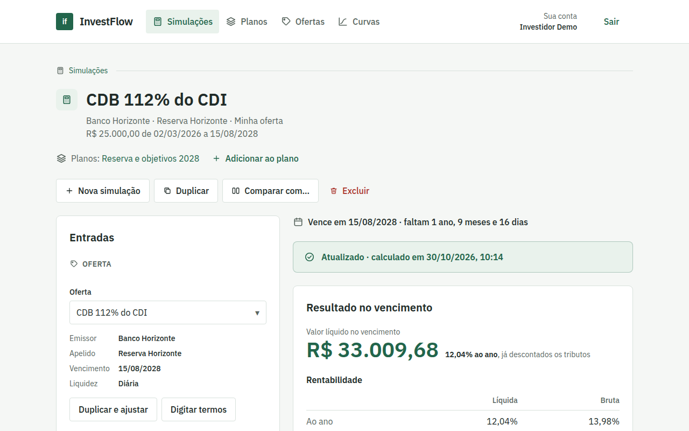
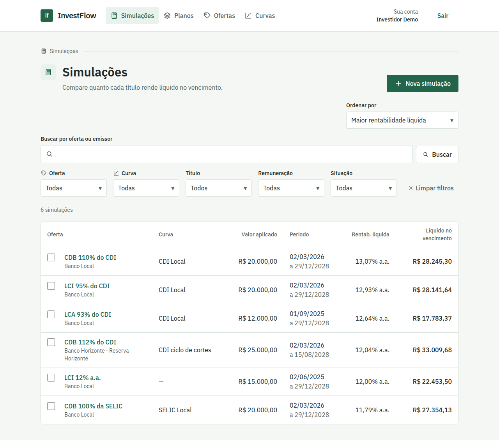
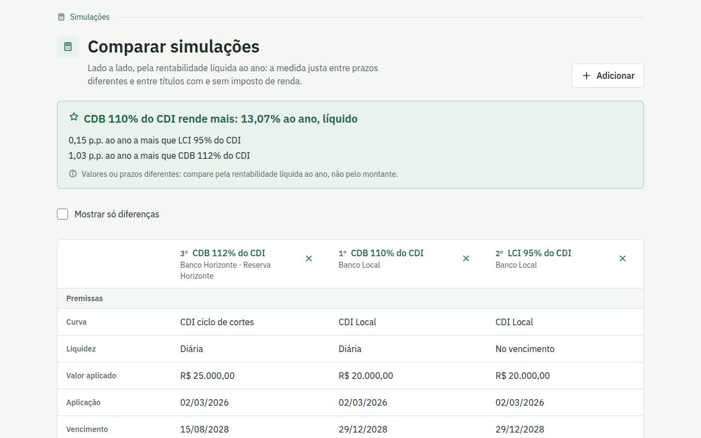
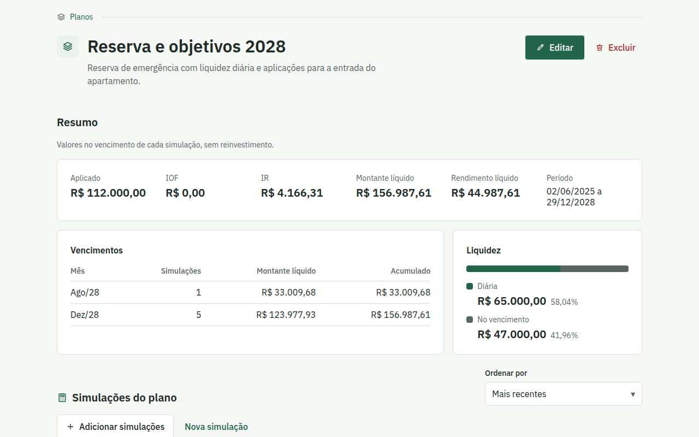
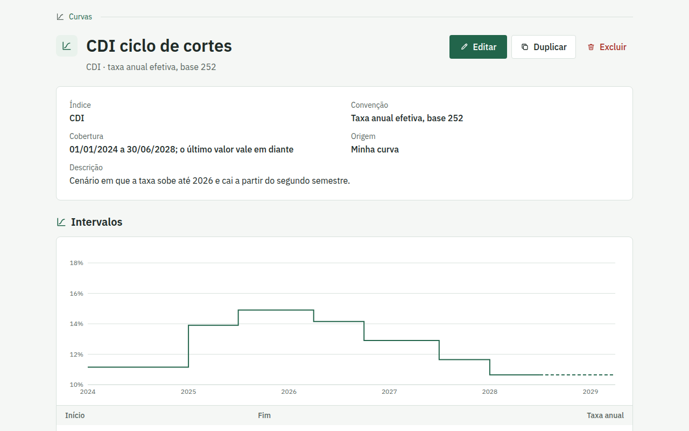
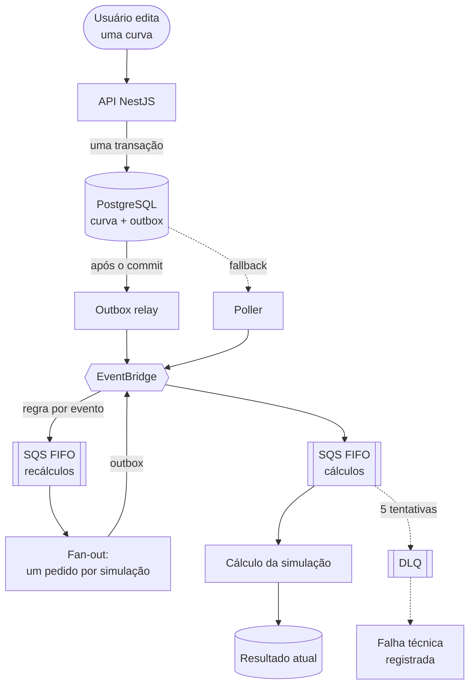

<div align="center">

# InvestFlow

**Simulador de renda fixa brasileira construído como exemplo de Event-Driven
Architecture e DDD em escala de produção.**

[](https://nodejs.org/)
[](https://www.typescriptlang.org/)
[](https://nestjs.com/)
[](https://react.dev/)
[](https://nx.dev/)
[](LICENSE)

[Funcionalidades](#funcionalidades) ·
[Arquitetura](#arquitetura) ·
[Como executar](#como-executar) ·
[Documentação](#documentação)



</div>

## Sobre

O InvestFlow responde à pergunta de quem vai investir em renda fixa: **quanto
recebo líquido no vencimento e quão bom isso é?** O usuário escolhe uma oferta
(CDB, LCI ou LCA, prefixada ou atrelada ao CDI ou à SELIC), informa o valor e a
data da aplicação, escolhe uma curva com a trajetória do índice e recebe o
resultado dia útil a dia útil, com IOF, imposto de renda e rentabilidade
líquida.

O que torna o problema interessante é que **as premissas mudam**. Ofertas e
curvas são editáveis, e cada mudança precisa recalcular, de forma assíncrona e
confiável, todas as simulações que dependem dela, sem perder nenhuma e sem
deixar um cálculo antigo sobrescrever um novo. Uma curva do sistema pode
alimentar milhares de simulações de muitos usuários.

O projeto existe para mostrar Event-Driven Architecture e Domain-Driven Design
resolvendo esse tipo de problema como em produção: cada decisão é julgada pelo
comportamento em escala, e não pelo volume de dados de hoje, usa padrões
conhecidos e registra seus custos.

> [!NOTE]
> Simulador educacional: não executa transações financeiras nem recomenda
> investimentos.

## Sumário

- [Funcionalidades](#funcionalidades)
- [Arquitetura](#arquitetura)
- [Tecnologias](#tecnologias)
- [Como executar](#como-executar)
- [Comandos](#comandos)
- [Estrutura do repositório](#estrutura-do-repositório)
- [Qualidade](#qualidade)
- [Documentação](#documentação)
- [Desenvolvimento com agentes de IA](#desenvolvimento-com-agentes-de-ia)
- [Licença](#licença)

## Funcionalidades

### Simulações

Valor líquido no vencimento, rentabilidade ao ano, ao mês e no período, IOF e
IR com a faixa aplicada explicada, prazo restante e a evolução do saldo mês a
mês. O resultado mostra sempre a situação do cálculo ("Calculando",
"Atualizado", "Requer ação", "Falha técnica") e se atualiza sozinho quando uma
premissa muda. A lista filtra, busca e ordena pela rentabilidade líquida.



### Comparação

De 2 a 6 simulações lado a lado, classificadas pela rentabilidade líquida ao
ano, a medida justa entre prazos diferentes e entre títulos com e sem imposto
de renda. Quando valor e prazo coincidem, a diferença também aparece em reais.



### Planos de investimento

Reúnem as simulações que seriam investidas juntas e somam aplicado, tributos e
montante líquido, com o calendário de vencimentos e a divisão entre liquidez
diária e no vencimento.



### Ofertas e curvas

Ofertas e curvas do sistema são públicas e somente leitura; o usuário cria as
suas ou duplica as do sistema. Uma curva é editada em uma tabela de intervalos
que se mantém contígua, e o último valor vale em diante, sempre identificado no
gráfico.



As regras de negócio completas estão no
[PRD](docs/product/investment-simulator-prd.md) e na
[especificação das curvas](docs/product/index-value-curves.md).

## Arquitetura

Um **monólito modular** em NestJS: cada bounded context vive em
`libs/<contexto>/` dividido em projetos Nx `domain`, `application` e
`infrastructure` (mais `web`, para as telas), e o lint impede que o domínio
dependa de framework ou que um contexto importe o interior de outro. Os apps
em `apps/` são só raízes de composição, o que permite levar um contexto para
outro host (um serviço ou uma Lambda) sem mover seu código.

### O fluxo de um recálculo



### Decisões e seus custos

| Problema                                               | Solução                                                                                                                              | Custo aceito                                             |
| ------------------------------------------------------ | ------------------------------------------------------------------------------------------------------------------------------------ | -------------------------------------------------------- |
| Gravar a mudança e o evento sem perder nenhum dos dois | **Transactional outbox**: o evento é gravado na mesma transação da mudança                                                           | Uma tabela a mais e um processo para publicá-la          |
| Latência da publicação                                 | O relay publica logo após o commit; o poller só recupera o que ficou para trás                                                       | Dois caminhos de publicação para manter                  |
| Duas mudanças da mesma simulação ao mesmo tempo        | **SQS FIFO agrupado por agregado**: mensagens da mesma simulação nunca são processadas em paralelo                                   | A vazão por agregado é sequencial                        |
| Entregas repetidas                                     | **Consumidores idempotentes**, deduplicados pelo ID do evento                                                                        | Um registro por evento processado                        |
| Um cálculo antigo sobrescrever um novo                 | Cada resultado guarda a **impressão digital das entradas** (revisões da simulação, da oferta, dos valores da curva e da metodologia) | A gravação é condicional e descarta resultados obsoletos |
| Uma curva usada por milhares de simulações             | **Fan-out** em lote: um pedido de cálculo por simulação, gravado em blocos na outbox                                                 | Picos de eventos, limitados pela cota de publicação      |
| Telas que precisam de fatos de negócio                 | **Consultas orientadas a tela** (Backend for Frontend) que calculam no servidor o que a tela mostra                                  | Uma consulta por tela em vez de endpoints genéricos      |

Medido com `pnpm bench:outbox` contra um broker que responde em 30 ms: com o
poller de 1 segundo que o relay substituiu, os eventos esperavam em média 5 s a
40 eventos por segundo e até 116 s em um fan-out de 3.000 eventos; com o relay,
esperam menos de 1 ms nessa carga e até 1,1 s no fan-out.

O desenho completo, com os limites e as alternativas descartadas, está em
[Mensageria](docs/architecture/messaging.md),
[Recálculo](docs/architecture/recalculation.md) e no
[fluxo de eventos](docs/architecture/event-flow.md).

## Tecnologias

| Camada     | Tecnologias                                                                                          |
| ---------- | ---------------------------------------------------------------------------------------------------- |
| Backend    | NestJS 11, Prisma 7, PostgreSQL 17, decimal.js                                                       |
| Mensageria | Amazon EventBridge e SQS FIFO, emulados localmente pelo [Floci](https://github.com/floci-io/floci)   |
| Frontend   | React 19, React Router (Data mode), TanStack Query, React Hook Form, Base UI, Tailwind CSS, Recharts |
| Identidade | Keycloak 26 (Authorization Code + PKCE)                                                              |
| Monorepo   | Nx, pnpm, ESLint com fronteiras entre projetos, Prettier                                             |
| Testes     | Jest (backend), Vitest (frontend), testes de integração contra PostgreSQL e Floci                    |

## Como executar

**Pré-requisitos:** Node.js 22 LTS, pnpm 10 e Docker.

```bash
git clone git@github.com:Diogo-NB/investflow.git
cd investflow
nvm use               # Node.js da versão em .nvmrc
corepack enable       # disponibiliza o pnpm
pnpm install
cp .env.example .env  # valores de desenvolvimento local
pnpm db:setup         # sobe PostgreSQL, Keycloak e Floci, migra e popula
pnpm start            # API e web
```

| Serviço           | Endereço                                   |
| ----------------- | ------------------------------------------ |
| Aplicativo web    | http://localhost:4200                      |
| API               | http://localhost:3000/api                  |
| Keycloak (admin)  | http://localhost:8080 (`admin` / `admin`)  |
| PostgreSQL        | `localhost:5432` (`postgres` / `postgres`) |
| Floci (AWS local) | http://localhost:4566                      |

Entre no aplicativo com o usuário de desenvolvimento **`investflow-dev`**,
senha **`investflow-dev`**. A carga inicial cria as ofertas e curvas do
sistema; as simulações e os planos são seus.

> [!TIP]
> `pnpm db:setup` apaga os dados locais do PostgreSQL e do Keycloak. Para
> apenas ligar e desligar os contêineres mantendo os dados, use `pnpm db:up` e
> `pnpm db:down`.

## Comandos

| Comando                  | O que faz                                                                                                |
| ------------------------ | -------------------------------------------------------------------------------------------------------- |
| `pnpm start`             | Sobe os contêineres e serve API e web (`start:api` e `start:web` para um só)                             |
| `pnpm test`              | Testes unitários de todos os projetos                                                                    |
| `pnpm check`             | Lint, testes, verificação de tipos e build de todos os projetos; roda em qualquer lugar, inclusive na CI |
| `pnpm check:integration` | `pnpm check` e os testes de integração contra o banco e o Floci (requer `pnpm db:up`)                    |
| `pnpm db:migrate`        | Cria e aplica uma migração do Prisma depois de mudar o schema                                            |
| `pnpm db:seed`           | Carrega as ofertas e curvas do sistema que ainda não existem                                             |
| `pnpm bench:outbox`      | Mede quanto tempo os eventos esperam para ser publicados (com a API parada)                              |

## Estrutura do repositório

```text
apps/
├── api/                       # host NestJS: composição, sem regra de negócio
└── web/                       # SPA React: autenticação e estrutura do app
libs/
├── investment-simulator/      # bounded context do simulador
│   ├── domain/                # agregados, objetos de valor, eventos; sem framework
│   ├── application/           # casos de uso e portas
│   ├── infrastructure/        # HTTP, Prisma, consumidores, consultas de tela
│   └── web/                   # telas de simulações, planos, ofertas e curvas
└── shared/                    # blocos comuns: datas, taxas, mensageria, persistência
infra/
├── keycloak/                  # realm de desenvolvimento
└── floci/                     # barramento e filas locais
tools/
├── database/                  # carga inicial
└── benchmarks/                # benchmark da outbox
docs/                          # produto (pt-BR), arquitetura e estado da implementação
```

O código de cada contexto é organizado por funcionalidade (`offers`,
`curves`, `simulations`, `investment-plans`) em todas as camadas, nunca por
tipo técnico. Detalhes em
[Estrutura do projeto](docs/architecture/project-structure.md).

## Qualidade

- **Fronteiras verificadas pelo lint:** o domínio só depende de domínio, a
  aplicação só de domínio e aplicação, e nenhum contexto importa o interior de
  outro.
- **Testes por camada:** regras de negócio testadas sem framework; repositórios,
  consultas e consumidores testados contra PostgreSQL e Floci reais em
  `pnpm check:integration`.
- **Dinheiro com precisão decimal:** nenhum cálculo usa ponto flutuante nem
  arredonda etapas intermediárias; só a exibição é arredondada.
- **Datas sem fuso:** datas civis e instantes são tipos distintos no domínio, e
  o calendário de dias úteis é uma regra do servidor.
- **Acessibilidade:** telas verificadas com teclado, zoom de 200%, movimento
  reduzido, larguras de 320 a 1440px e axe (WCAG A/AA).

## Documentação

O [índice da documentação](docs/README.md) diz o que cada arquivo cobre e
quando lê-lo.

- **Produto (pt-BR):** [PRD](docs/product/investment-simulator-prd.md),
  [curvas](docs/product/index-value-curves.md) e o comportamento de cada
  [tela](docs/product/screens/).
- **Arquitetura:** [mensageria](docs/architecture/messaging.md),
  [recálculo](docs/architecture/recalculation.md),
  [fluxo de eventos](docs/architecture/event-flow.md),
  [consultas](docs/architecture/queries.md) e
  [frontend](docs/architecture/frontend-patterns.md).
- **Implementação:** o que [já está construído](docs/implementation/current-state.md)
  e o que [está planejado](docs/implementation/planned/), como a importação
  das taxas do Banco Central.
- **Design visual:** [DESIGN.md](DESIGN.md).

## Desenvolvimento com agentes de IA

O repositório é preparado para trabalhar com agentes de código. O
[AGENTS.md](AGENTS.md) reúne as invariantes de arquitetura, as convenções e o
que precisa rodar antes de uma mudança ser considerada pronta, e
[`.agents/skills/`](.agents/skills/) tem uma skill por camada (domínio,
infraestrutura NestJS, eventos, React), por tipo de trabalho (planejamento,
testes locais) e para o benchmark. No Claude Code, um hook bloqueia a edição
de um arquivo até que a skill da sua camada seja carregada.

## Licença

Distribuído sob a [licença MIT](LICENSE).
