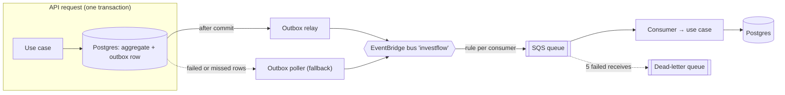
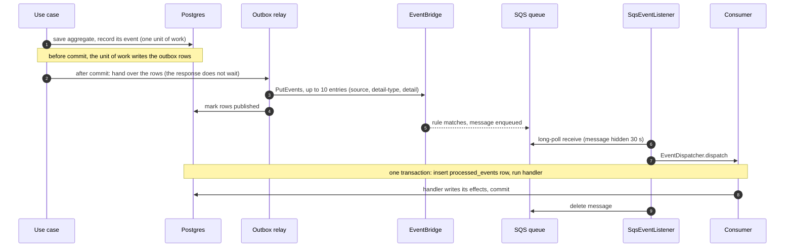
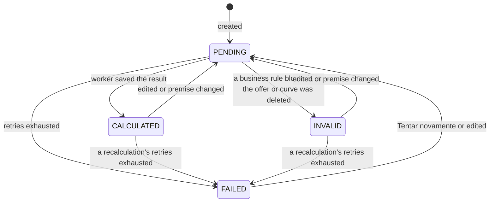
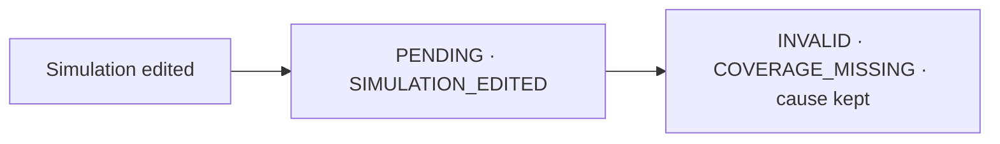
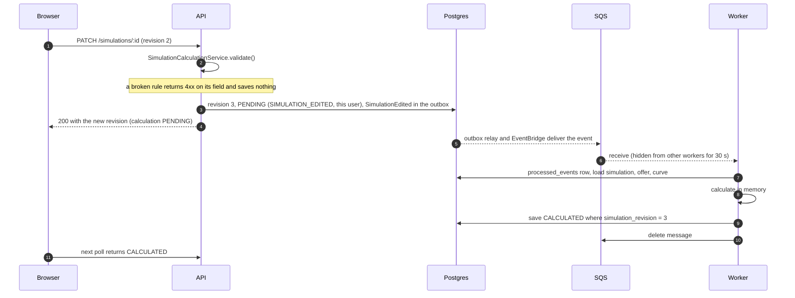
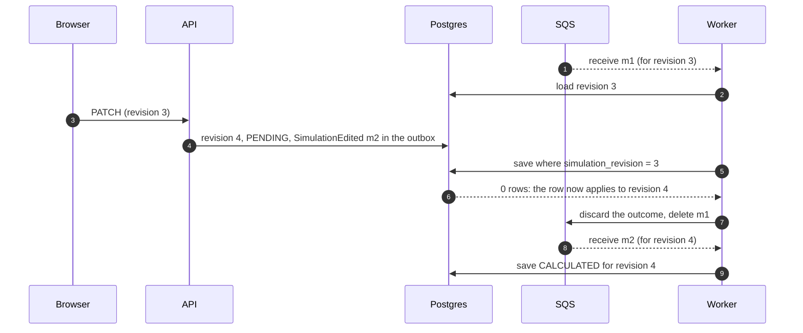
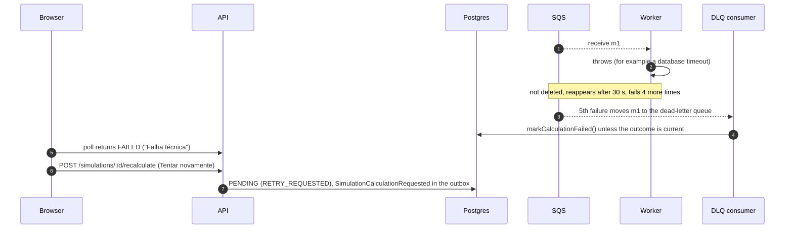
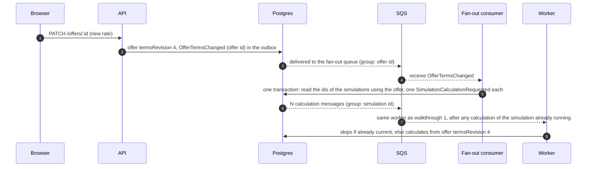
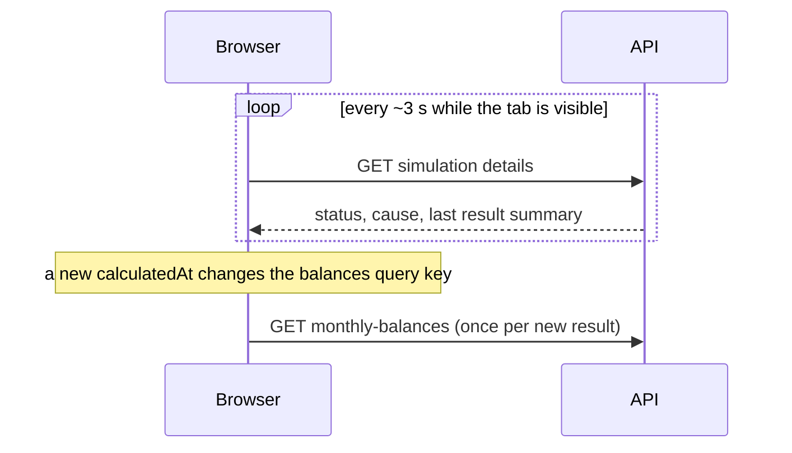

# Event Flow

A visual guide to how events move through InvestFlow, and how a simulation's
result is recalculated when anything it depends on changes. Read this first;
the rules behind it, and the outbox's limits and timings, are in
[Messaging Transport](./messaging.md) and
[Mutable Premises And Asynchronous Recalculation](./recalculation.md).

> **Status.** The event transport (outbox, EventBridge, SQS, consumers) and a
> simulation's own asynchronous calculation are built, on FIFO queues
> grouped per aggregate, and so is recalculation after offer and curve
> changes (walkthroughs 5 and 6); see
> [Current State](../implementation/current-state.md).

## In One Picture

Three ideas carry the whole design:

1. **A change and its event are saved together.** The event goes into an
   `outbox_events` row in the same transaction as the change, so there is
   never a change without its event, or an event without its change. Right
   after commit the relay publishes it from memory; the poller publishes
   whatever the relay could not.
2. **The queue does the delivery work.** SQS hands a message to one worker at
   a time, gives it to another if that worker dies, retries failures, and
   gives up into a dead-letter queue. Queues are FIFO and grouped by the
   event's aggregate, so one message per aggregate (one calculation per
   simulation) is in flight at a time across every worker. Our code never
   counts retries or holds locks.
3. **Consumers read current state.** Events carry identifiers only. A consumer
   loads what it needs from the database, so a late or duplicate event can
   never apply stale data.

## Vocabulary

| Term               | What it is                                                                                                   |
| ------------------ | ------------------------------------------------------------------------------------------------------------ |
| Domain event       | A past-tense fact, such as `OfferTermsChanged`. Carries identifiers, never values.                           |
| Unit of work       | `UnitOfWork.run()`: the transaction of a request or consumer. Its recorded events are written with it.       |
| Recorder           | `DomainEventRecorder`: records events in the unit of work. Repositories use it on save; services directly.   |
| Outbox             | The `outbox_events` table. Events wait here until published and are kept 7 days after.                       |
| After-commit hook  | A callback a unit of work runs once its transaction commits. Best effort: never run on rollback.             |
| Outbox relay       | `OutboxRelay`. Publishes a committed unit of work's rows from memory, right after commit.                    |
| Outbox publisher   | `OutboxPublisher`. Sends batches with a cap on calls in flight, marks rows, backs off failures, pauses.      |
| Outbox poller      | `OutboxPollerService`. Fallback: claims failed rows when due and rows older than a grace period.             |
| Bus                | The EventBridge bus `investflow`. Publishers send every event here and know nothing about consumers.         |
| Rule               | An EventBridge rule that copies matching events (by `source` and `detail-type`) into one consumer's queue.   |
| Queue              | One SQS FIFO queue per consumer, created by `consumer_queue` in `infra/floci/init/provision.sh`.             |
| Message group      | The event's `aggregateId`. SQS delivers a group's next message only after the current one is deleted.        |
| Visibility timeout | 30 seconds during which a received message is hidden from other workers. If it is not deleted, it reappears. |
| Dead-letter queue  | Where SQS moves a message after 5 failed receives. Every consumer queue has one.                             |
| Consumer           | A plain class with `@OnEvent('EventType')` methods that call a use case. Knows nothing about SQS.            |
| `EventDispatcher`  | Runs a consumer's handler in a transaction together with a `processed_events` row, so duplicates run once.   |
| Floci              | The local emulator of EventBridge and SQS used by `pnpm db:up`.                                              |

## Part 1: How Any Event Travels

### What if something fails?

| What fails                           | What happens                                                                               | Who handles it     |
| ------------------------------------ | ------------------------------------------------------------------------------------------ | ------------------ |
| The request's transaction rolls back | Neither the change nor the event exists.                                                   | Outbox             |
| EventBridge rejects or is down       | The row stays unpublished and is retried with backoff; publishing pauses during an outage. | Outbox poller      |
| The process stops before publishing  | The row stays unpublished; another poller claims it once its grace period passes.          | Outbox poller      |
| The process stops after publishing   | The row is published again; the consumer skips the duplicate.                              | `EventDispatcher`  |
| SQS delivers a message twice         | The second `processed_events` insert finds the first one and the handler is skipped.       | `EventDispatcher`  |
| The handler throws                   | The transaction rolls back, the message is not deleted, and it reappears after 30 seconds. | SQS                |
| The worker process dies mid-handler  | Same as a throw: the open transaction rolls back and the message reappears.                | SQS and Postgres   |
| The handler fails 5 times            | SQS moves the message to the dead-letter queue.                                            | SQS                |
| The message body is malformed        | It is not deleted, so it ends in the dead-letter queue after 5 receives.                   | `SqsEventListener` |

## Part 2: Simulation Recalculation

A simulation references an offer and, for indexed remuneration, a curve.
Offers and curves are editable, so a simulation's result must follow them.
Saving returns immediately and the result arrives a moment later.

### Statuses

| Status       | Screen shows                                                    | Who acts                   |
| ------------ | --------------------------------------------------------------- | -------------------------- |
| `PENDING`    | "Calculando" with its cause, over the last result marked as old | System                     |
| `CALCULATED` | "Atualizado" with the current result                            | Nobody                     |
| `INVALID`    | "Requer ação" with the reason and the change that led to it     | User                       |
| `FAILED`     | "Falha técnica" with "Tentar novamente"                         | System; the user can retry |

There is deliberately no "calculating" status. While a worker holds a
message, the simulation is simply `PENDING`; storing more would need leases
that a crashed worker could leave behind.

### The Calculation Record

Each simulation has one row in `simulation_calculation`, next to its
`simulation_result`. It is part of the `Simulation` aggregate as the
`SimulationCalculation` value object.

| Field                            | Holds                                                                                                                     |
| -------------------------------- | ------------------------------------------------------------------------------------------------------------------------- |
| `status`                         | `PENDING`, `CALCULATED`, `INVALID`, or `FAILED`                                                                           |
| `changed_at`                     | When it entered this status                                                                                               |
| `cause_kind`                     | Why it was last queued (list below)                                                                                       |
| `cause_actor_id`                 | Who made the change; `null` for system processes                                                                          |
| `simulation_revision`            | The simulation revision this status was written for; an outcome is saved only while it still matches                      |
| `input_fingerprint`              | Only for `CALCULATED` and `INVALID`: what the outcome was calculated from (see "Input fingerprint" in `recalculation.md`) |
| `reason_code`, `reason_metadata` | Only for `INVALID`: the stable error code and details, such as uncovered periods                                          |

Causes: `CREATED`, `SIMULATION_EDITED`, `METHODOLOGY_CHANGED`,
`RETRY_REQUESTED`. There are no offer or curve causes: fan-out writes no
calculation rows, so nothing would set them.

The cause is set when the simulation is queued, and the worker keeps it when
it writes the outcome. "The worker did it" explains nothing; "the
simulation was edited" does:

Only the current state is kept; a calculation history is outside the MVP
([PRD](../product/investment-simulator-prd.md#fora-do-escopo-do-mvp)).

### Who Does What

| Layer          | Piece                                       | Responsibility                                                                                                                                                         |
| -------------- | ------------------------------------------- | ---------------------------------------------------------------------------------------------------------------------------------------------------------------------- |
| Domain         | `Simulation`                                | Sets `PENDING` with a cause and raises `SimulationCreated`, `SimulationEdited`, or `SimulationCalculationRequested`; accepts an outcome only for its current revision. |
| Domain         | `SimulationCalculationService`              | `validate()`: the rules checked in the request. `calculate()`: a `CALCULATED` or `INVALID` outcome; throws on technical failure.                                       |
| Domain         | `InvestmentCalculator`                      | `check()`: supported remuneration and business days. `calculate()`: the numbers, including curve coverage.                                                             |
| Application    | Create, edit, retry use cases               | Check visibility, validate, save.                                                                                                                                      |
| Application    | `CalculateSimulationUseCase`                | Load current state, calculate, record, save; a conflict is a discard.                                                                                                  |
| Infrastructure | `SimulationCalculationConsumer`             | One `@OnEvent` per event above, all calculating; throws on technical failure so SQS retries.                                                                           |
| Infrastructure | Dead-letter consumer                        | Sets `FAILED` unless the outcome is current for the premises.                                                                                                          |
| Infrastructure | Repository                                  | Conditional update of `simulation_calculation` on the revisions read.                                                                                                  |
| SQS            | `simulation-calculations` queue and its DLQ | One worker per message, redelivery, retries, giving up.                                                                                                                |

### Walkthrough 1: Saving a Simulation

Every rule except curve coverage is checked in the request: principal,
period, minimum term, curve required, compatible and not deleted, supported
remuneration, and business days. Coverage needs the whole calculation, so
only the worker finds it.

### Walkthrough 2: Saving Again During a Calculation

Edits always win. The losing worker returns normally, because whatever made
its inputs out of date queued its own message.

### Walkthrough 3: A Business Rule Blocks the Calculation

The worker finds that the curve has no values for part of the period. That is
an outcome, not an error: it saves `INVALID` with `INVESTMENT_CURVE_COVERAGE_MISSING`
and the uncovered periods, keeps the last successful result and the cause,
and deletes the message. Retrying would give the same answer. Editing the
simulation or the curve queues it again.

### Walkthrough 4: Technical Failure

The dead-letter consumer writes `FAILED` over `PENDING` or over an outcome
for older inputs, such as a result made stale by an offer change whose
recalculation failed. An outcome current for the premises stands, and the
write requires the row to be unchanged since it was read, so it never
replaces an outcome written meanwhile. If a newer message for the same
revision is already in flight (a retry, or saving without changes), the
screen may show "Falha técnica" briefly before that calculation replaces it.

### Walkthrough 5: An Offer's Terms or a Curve's Values Change

Only facts that affect a calculation fan out: `OfferTermsChanged`,
`OfferDeleted`, `CurveValuesChanged`, and `CurveDeleted`. Renaming an offer or
describing a curve (`OfferDetailsChanged`, `CurveDetailsChanged`) reaches no
consumer and leaves its simulations up to date. Fan-out never loads
simulations and writes no calculation rows: until each result lands, the
screen shows "Desatualizado", derived from the term revisions. It records
all its requests in one transaction, a simplification covered by
the planned [Fan-out at Scale](../implementation/planned/fan-out-at-scale.md).

### Walkthrough 6: An Offer or Curve Is Deleted

Deletion goes through the same path as walkthrough 5. The worker finds the
premise missing and records `INVALID` with the reason ("Sem oferta, escolha
outra" or "Sem curva, escolha outra"). Fan-out never writes `INVALID`
itself: if a user switched a simulation to another premise meanwhile, the
worker merely recalculates it from the new one. Choosing another offer or
curve is an edit, which queues a calculation.

### The Guard: Three Rules

1. **Edits always win.** User edits and fan-out set `PENDING` without looking
   at the calculation state.
2. **Workers write only if still current.** The save requires the
   calculation row to still apply to the simulation revision the worker read.
3. **Losing is harmless.** A worker that loses discards its outcome and
   acknowledges the message; the newer change already queued a newer
   calculation.

The guard does not check the offer and curve revisions. It does not need to:
messages are grouped by simulation, so the calculation queued by a premise
change waits for the running one and then reads the latest premises. An
outcome from an older premise may land first and show "Desatualizado" for a
moment, but it is never the last write.

### When Things Go Wrong

| Situation                                | Outcome                                                                        |
| ---------------------------------------- | ------------------------------------------------------------------------------ |
| The same message arrives twice           | `processed_events` runs it once.                                               |
| Two messages for one simulation          | Their group delivers them one after the other; the second reads current state. |
| The user edits during a calculation      | The old outcome is discarded; the new message calculates.                      |
| The premise changes during a calculation | The old outcome may land; fan-out's message runs next and replaces it.         |
| A worker dies mid-calculation            | The message reappears after 30 seconds and another worker takes it.            |
| A technical error keeps happening        | After 5 receives the message is dead-lettered and the status is `FAILED`.      |
| A business rule fails                    | `INVALID` with the reason, recorded once and never retried.                    |
| The simulation was deleted               | The worker finds nothing to calculate and acknowledges the message.            |

## How the Screen Stays Current

The simulation's page polls its details endpoint about every 3 seconds,
whatever the status. The response is small, so there is no change token and
no extra endpoint.

- Polling pauses while the tab is hidden and refetches on focus (TanStack
  Query defaults).
- A refetch updates the status and result panels, never the form: the editor
  keeps the revision it was loaded or last saved at (`PATCH` answers the new
  one) and sends it, so a change made elsewhere is a `409` on save. When a
  poll shows a newer revision, the screen offers to reload.
- If polling load ever shows up, an `ETag` with `304` can be added to the same
  endpoint without client changes. Real-time push is future work.

## Event Catalog

Every domain event the system raises. A change that adds, renames, removes,
or re-routes an event updates this table in the same change. Every event
carries the shared envelope (`eventId`, `eventType`, `version`, `context`,
`aggregateType`, `aggregateId`, `occurredAt`); "Payload" lists only what
it adds.

| Event                            | Raised by                                                             | Business fact                                               | Payload | Consumers (queue)                                                                                             |
| -------------------------------- | --------------------------------------------------------------------- | ----------------------------------------------------------- | ------- | ------------------------------------------------------------------------------------------------------------- |
| `OfferCreated`                   | `Offer`                                                               | An offer was created, in the catalog or for one simulation  | none    | none                                                                                                          |
| `OfferTermsChanged`              | `Offer`                                                               | Its maturity, redemption, or remuneration terms changed     | none    | `SimulationRecalculationConsumer` (`simulation-recalculations`)                                               |
| `OfferDetailsChanged`            | `Offer`                                                               | Its name or issuer changed                                  | none    | none                                                                                                          |
| `OfferDeleted`                   | `Offer`                                                               | An offer was deleted                                        | none    | `SimulationRecalculationConsumer` (`simulation-recalculations`)                                               |
| `OfferMovedToCatalog`            | `Offer`                                                               | A simulation's own terms became an offer listed in Ofertas  | none    | none                                                                                                          |
| `CurveCreated`                   | `Curve`                                                               | A curve was created                                         | none    | none                                                                                                          |
| `CurveValuesChanged`             | `Curve`                                                               | Its intervals or values changed                             | none    | `SimulationRecalculationConsumer` (`simulation-recalculations`)                                               |
| `CurveDetailsChanged`            | `Curve`                                                               | Its name or description changed                             | none    | none                                                                                                          |
| `CurveDeleted`                   | `Curve`                                                               | A curve was deleted                                         | none    | `SimulationRecalculationConsumer` (`simulation-recalculations`)                                               |
| `SimulationCreated`              | `Simulation`                                                          | A simulation was created and waits for its calculation      | none    | `SimulationCalculationConsumer` (`simulation-calculations`), `SimulationCalculationFailureConsumer` (its DLQ) |
| `SimulationEdited`               | `Simulation`                                                          | A simulation was saved and waits for its calculation        | none    | `SimulationCalculationConsumer` (`simulation-calculations`), `SimulationCalculationFailureConsumer` (its DLQ) |
| `SimulationCalculationRequested` | `Simulation`; the offer and curve fan-out use cases record it in bulk | A calculation was asked for without changing the simulation | none    | `SimulationCalculationConsumer` (`simulation-calculations`), `SimulationCalculationFailureConsumer` (its DLQ) |

## Adding or Changing an Event

1. Name it after the business fact, in the past tense. Never
   `<Aggregate>Changed` or `<Aggregate>Updated`; split an aggregate's changes
   into separate events when consumers react to them differently, as
   `OfferTermsChanged` and `OfferDetailsChanged` are.
2. Add only payload fields a consumer needs and cannot read from current
   state. Consumers read current state, so most events carry identifiers
   only.
3. Raise it from aggregate behavior with `apply()`, or record it with
   `DomainEventRecorder` for bulk work that loads no aggregates.
4. Route it: add its type to the event pattern of each consuming queue in
   `infra/floci/init/provision.sh`, and an `@OnEvent` method to each consumer.
5. Update the catalog above. Changing an existing payload is a new
   `version`.

## Where the Code Lives

| Piece                                                          | Path                                                                     |
| -------------------------------------------------------------- | ------------------------------------------------------------------------ |
| Outbox writer, relay, publisher, poller, broker port, recorder | `libs/shared/infrastructure/src/lib/messaging/outbox`                    |
| Publishing latency benchmark (`pnpm bench:outbox`)             | `tools/benchmarks/outbox-latency.ts`                                     |
| `UnitOfWork` and its commit hooks                              | `libs/shared/infrastructure/src/lib/persistence`                         |
| EventBridge adapter                                            | `libs/shared/infrastructure/src/lib/messaging/eventbridge`               |
| `EventDispatcher`, `@OnEvent`                                  | `libs/shared/infrastructure/src/lib/messaging/consumers`                 |
| `SqsEventListener`, `SqsConsumersModule`                       | `libs/shared/infrastructure/src/lib/messaging/sqs`                       |
| Queues, rules, dead-letter queues                              | `infra/floci/init/provision.sh`                                          |
| Offer and curve events                                         | `libs/investment-simulator/domain/src/lib/offers`, `.../curves`          |
| Simulation, calculation service                                | `libs/investment-simulator/domain/src/lib/simulations`                   |
| Calculation, failure, retry, fan-out use cases                 | `libs/investment-simulator/application/src/lib/simulations`              |
| Calculation, dead-letter, fan-out consumers                    | `libs/investment-simulator/infrastructure/src/lib/simulations/messaging` |

## Adding a New Consumer

1. Write the consumer in the owning context's infrastructure: an
   `@Injectable()` class with one `@OnEvent('EventType')` method per event,
   each calling a use case. Class names must be unique.
2. Add `consumer_queue <name> '<event pattern>'` to
   `infra/floci/init/provision.sh`. It creates the FIFO queue, its FIFO
   dead-letter queue, and the rule, whose target groups messages by
   `$.detail.aggregateId`.
3. Add the queue URL to `.env.example` and bind the consumer in the host
   with `SqsConsumersModule.register([{ consumer, queueUrlConfigKey }])`.
4. Make the effect idempotent and read current state. Throw only for failures
   a retry can fix; return normally when the work is no longer needed.
5. Test the use case directly; `messaging.integration.spec.ts` covers the
   transport end to end against Floci.

## Related Docs

- [Messaging Transport](./messaging.md) and
  [Mutable Premises And Asynchronous Recalculation](./recalculation.md).
- [PRD](../product/investment-simulator-prd.md): "Modelo de Atualização" and
  "Cálculos de Simulação".
- `$investflow-eventing`: rules for publishing and consuming.
